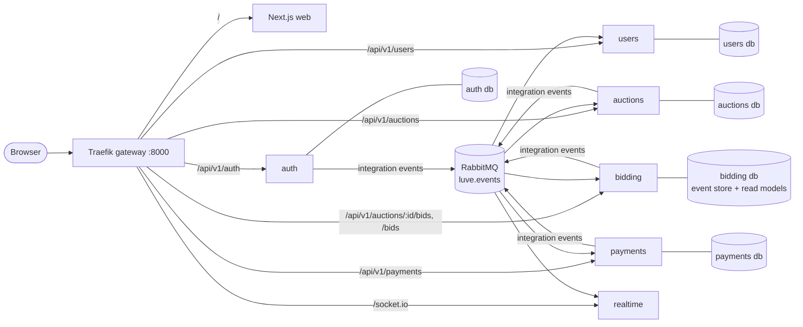

# Luve

An auction site built as a **learning / portfolio project** for backend architecture: NestJS microservices, **event sourcing + CQRS** for bidding, a message broker with the outbox pattern, an API gateway, and per-service CI/CD, all in one monorepo.

> Not meant for production. The point is to show (and learn) the patterns, explained along the way in [`docs/`](docs/).



| Path | What |
|---|---|
| [`apps/web`](apps/web) | Next.js frontend; typed API clients generated with Orval from each service's OpenAPI |
| [`services/auth`](services/auth) | logging in: accounts (email + password), sessions, access tokens (JWT + JWKS) |
| [`services/users`](services/users) | profiles: username (later picture, location, …) |
| [`services/auctions`](services/auctions) | auction listings and lifecycle |
| [`services/bidding`](services/bidding) | bidding, **event-sourced** with [`@ocoda/event-sourcing`](https://github.com/ocoda/event-sourcing) |
| [`services/payments`](services/payments) | Stripe checkout for won auctions |
| [`services/realtime`](services/realtime) | Socket.IO push of bids and status changes |
| [`packages/contracts`](packages/contracts) | the event schemas services agree on |
| [`packages/messaging`](packages/messaging) | RabbitMQ + transactional outbox, for services that publish events |
| [`infra/`](infra) | Postgres init, RabbitMQ definitions, Traefik routes |
| [`docs/`](docs) | [architecture](docs/architecture.md), [roadmap](docs/roadmap.md), [decision records](docs/adr) |

The services are being built phase by phase. See the [roadmap](docs/roadmap.md) for what works today.

## Stack

NestJS 12 (ESM) · TypeScript 6 · Zod 4 (Standard Schema validation + OpenAPI) · Prisma 7 · PostgreSQL 16 · RabbitMQ 4 · Redis 7 · Traefik 3 · Next.js 15 + TanStack Query + Orval · Vitest · pnpm workspaces + Turborepo · GitHub Actions → GHCR

## Running it

Requirements: Node ≥ 22.12, pnpm 10 (`corepack enable` or `npm i -g pnpm`), Docker.

```bash
pnpm install
pnpm env:init      # copies every .env.example to .env (never overwrites)
pnpm infra:up      # Postgres, Redis, RabbitMQ, Traefik in Docker
pnpm dev           # all services + web on the host, in watch mode
```

Open **http://localhost:8000**. Everything (web app, APIs, websockets) goes through the gateway on that one origin.

First time? Create demo accounts and a stable token-signing key:

```bash
pnpm --filter @luve/auth db:deploy        # apply the migrations
pnpm --filter @luve/users db:deploy
pnpm --filter @luve/auth keys:generate    # optional: tokens survive restarts
pnpm seed                                 # with `pnpm dev` running: alice@luve.dev / bob@luve.dev, password Password123
```

Or run everything in containers: `pnpm stack:up` (and `pnpm stack:down`).

| URL | |
|---|---|
| http://localhost:8000 | the app (via Traefik) |
| http://localhost:8000/docs/auth, /docs/users | Swagger UI of the services that have endpoints |
| http://localhost:8088 | Traefik dashboard |
| http://localhost:15673 | RabbitMQ management (luve / luve); queue `luve.audit` receives every event, `luve.dead-letters` the ones a consumer rejected |
| `localhost:5433` | Postgres (luve / luve), one database per service |

Direct service ports (bypassing the gateway): auth 4001, auctions 4002, bidding 4003, payments 4004, realtime 4005, users 4006, web 3000.

## Everyday commands

```bash
pnpm build | test | lint | typecheck    # turbo runs them across the workspace
pnpm openapi                            # export every service's openapi.json
pnpm api:generate                       # regenerate the web's typed clients (Orval)
pnpm turbo run test --filter=@luve/auth   # one package (e2e tests start Postgres/RabbitMQ via Testcontainers)
pnpm --filter @luve/web exec playwright test --project=chromium   # browser tests, with the stack running
```

> **Windows:** Docker Desktop doesn't forward file-change events into bind mounts, so after editing `infra/traefik/**` run `docker compose restart traefik`.

## CI/CD

Each service has its own workflow ([`.github/workflows`](.github/workflows)) that runs only when that service or a shared package changes, via one reusable pipeline: lint → typecheck → test → build → OpenAPI/client drift check → Docker image pushed to GHCR (on `main`).
