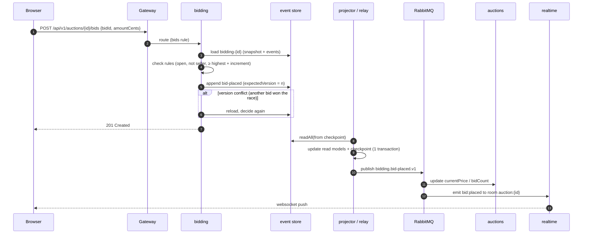

# Architecture

Luve is split into small NestJS services that each own their data and talk to each other through events. Bidding, the most interesting part of an auction, is **event-sourced**. Why each choice was made is recorded in the [ADRs](adr/).

## Services

| Service | Owns | Storage | Publishes | Consumes |
|---|---|---|---|---|
| **auth** | accounts (email, username, password hash), sessions, JWT signing keys (JWKS) | Postgres (Prisma) + outbox | `user-registered`, `user-updated`, `user-deleted` | none |
| **users** | public profiles: a copy of each user's id, username and join date | Postgres (Prisma) | none | auth `user-*` |
| **auctions** | listings, images, lifecycle status, a local copy of seller names | Postgres (Prisma) + outbox/inbox | `auction-published`, `auction-cancellation-requested`, `auction-status-changed` | auth `user-*`; bidding `bid-placed`, `bidding-extended`, `bidding-closed`, `bidding-cancelled`, `cancellation-rejected`; payments `*` |
| **bidding** | bidding per auction (**ES + CQRS**) | event store (Postgres schema `eventstore`) + read models (Prisma, schema `public`) | `bidding-opened`, `bid-placed`, `bidding-extended`, `bidding-closed`, `bidding-cancelled`, `cancellation-rejected` | auctions `auction-published`, `auction-cancellation-requested` |
| **payments** | Stripe checkout + webhook, who has to pay how much | Postgres (Prisma) + outbox/inbox | `checkout-started`, `payment-succeeded`, `payment-expired` | bidding `bidding-closed`; auctions `auction-published` |
| **realtime** | Socket.IO rooms `auction:{id}` and `user:{id}`; push only, bids go through REST | Redis adapter | none | bidding `*`, auctions `auction-status-changed` |
| **notifications** *(planned)* | outbid / won / sold / paid emails | Postgres (email directory) | none | auth `user-*`, bidding, payments |

Rules every service follows:

- **One database per service.** No service reads another service's tables. If a service needs someone else's data (e.g. a seller's username), it keeps a local copy fed by events.
- **No synchronous calls between services on the hot path.** Placing a bid never waits on another service.
- **Money is integer euro cents.** IDs are UUIDv7.
- **Errors use NestJS's default shape** `{ statusCode, message, error }`. Validation errors list one `field: message` per problem, so forms can show them next to the right input.

## Gateway

Traefik is the only thing the browser talks to (`http://localhost:8000`). It serves the Next.js app and routes the API by **resource**, so the browser never learns how the backend is split:

| Path | Service |
|---|---|
| `/api/v1/auth/*` | auth |
| `/api/v1/users/*` | users |
| `/api/v1/auctions/*` | auctions |
| `/api/v1/auctions/{id}/bids`, `/api/v1/bids/*` | bidding (higher priority than auctions) |
| `/api/v1/payments/*` | payments |
| `/socket.io/*` | realtime |
| `/docs/<service>` | that service's Swagger UI |
| everything else | web |

Because web and API share an origin there is no CORS, and the auth cookies are plain first-party cookies. Routes live in [`infra/traefik`](../infra/traefik): `host/` for `pnpm dev`, `docker/` for the full container stack.

## Authentication

The auth service signs short-lived access tokens (Ed25519 JWT, 15 min) and publishes its public keys at `/.well-known/jwks.json`. Services verify tokens **locally** against those keys; nobody calls auth per request. (Today only auth has protected routes; its `JwtAuthGuard` verifies with the key directly.) The browser holds the tokens in httpOnly cookies (`jwt`, and `refresh` scoped to `/api/v1/auth`). Refresh tokens rotate on every use, and reusing an old one revokes the whole session family.

## Messaging

- RabbitMQ topic exchange **`luve.events`**, routing key `<service>.<event>.v<n>` (e.g. `bidding.bid-placed.v1`), plus dead-letter exchange `luve.events.dlx`.
- Every message is an envelope `{ eventId, type, occurredAt, correlationId, causationId, producer, data }`. The schemas are Zod, in `@luve/contracts`, validated on publish and on consume. `eventId` is the AMQP `messageId`.
- **Outbox:** a service writes its state change and the outgoing event in the **same database transaction**; a relay publishes the outbox afterwards. A crash can't lose an event or publish one for a change that rolled back. Implemented with [`@nestjs/outbox`](https://docs.nestjs.com/reliability/outbox) (tables in the service's own database, schema `nest_outbox`) and a small RabbitMQ transport in `@luve/messaging` that only reports success once the broker confirmed the publish. See [ADR 0006](adr/0006-nestjs-outbox.md).
- **Consumers:** each consuming service has its own durable queue (e.g. `luve.users`), declared by the service when it starts. RabbitMQ delivers at least once, so every handler is safe to run twice (create-if-missing, update, delete). A message a handler rejects goes to **`luve.dead-letters`** instead of being retried forever.
- [`infra/rabbitmq/definitions.json`](../infra/rabbitmq/definitions.json) declares the exchanges, the dead-letter queue and the dev queue **`luve.audit`**, which is bound to `#` and works as a live event log in the management UI.
- Events from the bidding stream carry the **stream version**, so consumers can ignore stale or duplicate updates even if messages arrive out of order.

## Bidding: event sourcing + CQRS

Bidding is the one place where state is stored as **events**, not rows. Each auction's bidding is an aggregate (`AuctionBidding`) with its own stream `bidding-{auctionId}`:

| Event | Data |
|---|---|
| `bidding-opened` | sellerId, startingPriceCents, incrementCents, endsAt |
| `bid-placed` | bidId, bidderId, amountCents, placedAt |
| `bidding-extended` | endsAt (anti-sniping) |
| `bidding-closed` | winnerId?, winningAmountCents? |
| `bidding-cancelled` | none |

**Write side (commands).** `PlaceBid` loads the aggregate by replaying its events (snapshots every 50 events keep that fast), checks the rules, and appends `bid-placed`:

- the stream is open (not closed or cancelled) and `now < endsAt`;
- the bidder isn't the seller;
- the amount is at least the starting price (first bid) or the highest bid + increment;
- a client-supplied `bidId` makes retries idempotent.

Appends use **optimistic concurrency**: the expected stream version must match. When two bids race, one append fails with a version conflict; that command reloads and decides again (up to 3 times), so the loser is re-checked against the new highest bid. Two bids can never both win, and a bid racing the close is re-checked too.

**Read side (queries).** ocoda's in-process publishing is at-most-once, so read models and outgoing events are built by **pulling** instead:

- A **projector** tails the store in global order (`readAll` from its checkpoint; the Postgres store is gap-safe). It updates `bid_history`, `bidding_state` and `bidder_participation` **and its checkpoint in one transaction**, so each event is applied effectively once. Rebuilding a read model means replaying from position 0.
- A **relay** tails the same log, maps domain events to integration events, publishes them and advances its own checkpoint (at-least-once).
- A Postgres advisory lock ensures one tailer of each kind across instances. An in-process subscriber nudges both on every append for low latency; a 1 s poll is the fallback.

**Lifecycle.** `auction-published` (from auctions) → `OpenBidding`, which appends at expected version 0, so a redelivered message is harmless. A bid that arrives before that gets `409 bidding-not-open`. A BullMQ delayed job fires `CloseBidding` at `endsAt` (idempotent; it does nothing if `endsAt` moved), and a periodic sweeper closes anything overdue in case Redis lost the job.

**Cancellation saga.** The seller deletes an auction → auctions marks it `cancelling` and emits `auction-cancellation-requested` → bidding answers `bidding-cancelled` (no bids yet) or `cancellation-rejected` (bids exist) → auctions finalises or reverts. Bidding is the authority because only it knows about bids.

## Auction lifecycle

`active` → `awaiting_payment` (bidding closed with a winner) → `payment_pending` (checkout started) → `paid` (payment succeeded). Without bids: `unsold`. Cancellation: `active` → `cancelling` → `cancelled` or back to `active`. Prices and `endsAt` are fixed once published, because bidding owns them from then on.

## Payments

Only the winner can pay. Payments checks this against its own copy of `bidding-closed` (and answers 409 until that event has arrived), and the amount comes only from that event. The Stripe idempotency key is `auction-<id>`. Webhooks are signature-verified and deduplicated by Stripe `event.id`.

## Shared code

- **No shared service setup.** Each service has its own `main.ts`, plus a `setup.ts` (routing under `/api/v1`, Zod validation, Swagger at `/docs/<name>`) once it has endpoints. A few lines repeat between services on purpose; see [ADR 0008](adr/0008-no-shared-service-kit.md). Production plumbing (health checks, structured logging, a shared error format) is left out and can be added later.
- **`@luve/contracts`**: integration-event schemas (`defineEvent('auth.user-registered.v1', zodSchema)`) with JSON fixtures that producers and consumers both test against.
- **`@luve/messaging`**: `MessagingModule.forRoot({ service, prisma })` wires RabbitMQ and the outbox; `IntegrationEvents.stage(tx, Contract, data)` validates an event against its contract and adds it to the outbox inside the caller's transaction. Consumers and the inbox follow in Phase 2.

## Frontend contract

Every service commits its `openapi.json`. Orval turns each one into typed TanStack Query hooks in `apps/web/src/api/generated/<service>/`. CI regenerates both and fails on any diff, so an API change can't land without the client that matches it.
